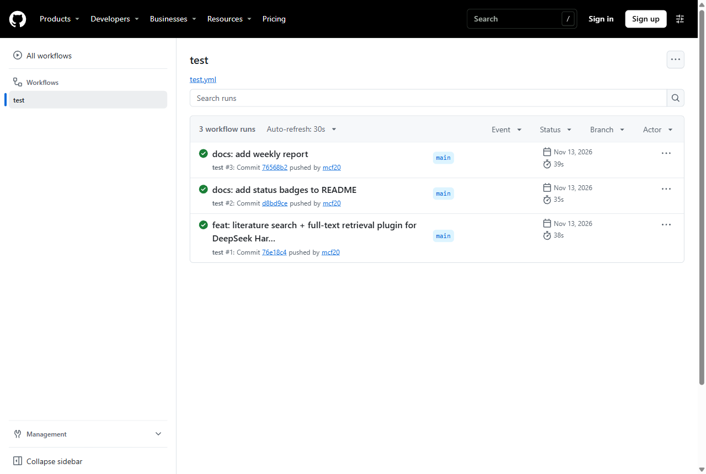

# 周报（精简版 · 一页）

**周期**：2026-11-10 ~ 2026-11-13　**项目**：文献检索与全文获取插件 dsh-literature

---

## 做了什么

做了一个插件，解决"**检索工具能找到论文，但拿不到全文**"的问题。

检索工具（OpenAlex、Crossref、PubMed）只给题目、摘要、DOI，点进去往往还要订阅或登录；
用脚本直接抓 PDF 又普遍被出版社拦下。插件在**读者本人有权限的前提下**，把全文自动取回本地。

## 怎么做的

把问题拆成两层，因为它们的瓶颈完全不同：

- **检索**：5 个源并行（OpenAlex、Crossref、arXiv、PubMed、Semantic Scholar），按 DOI + 标题去重
- **全文**：9 个开放获取接口并行询问 + 5 级下载降级（直连 → 浏览器下载 → 响应拦截 → 签名链 → 手动导入）

关键设计是**降级而不是死磕**：一级失败就换下一级，并如实报告卡在哪一步，
不把"没拿到"说成"拿到了"。

## 结果

| 指标 | 数值 |
|---|---|
| 代码 | 14 个模块 / 4,416 行 |
| 工具 | 8 个 |
| 单元测试 | 20 项全过 |
| 实证 | 18 篇论文完整全文入库（253 MB） |
| 获取路径 | 7 条不同机制，每条都实际跑通 |
| 持续集成 | 三平台 × 两版本，6 个组合全绿 |
| 开源 | https://github.com/mcf20/dsh-literature |

## 限制（如实）

订阅刊的 PDF 导出不授权给科技接口，正文改走 XML；中文文献无公开 API 未接入；
图表不单独提取；部分出版社仍需人工点一次。

## 下一步

找同学试用收集真实失败案例 → 补中文通道调研 → 解析升级。

---

