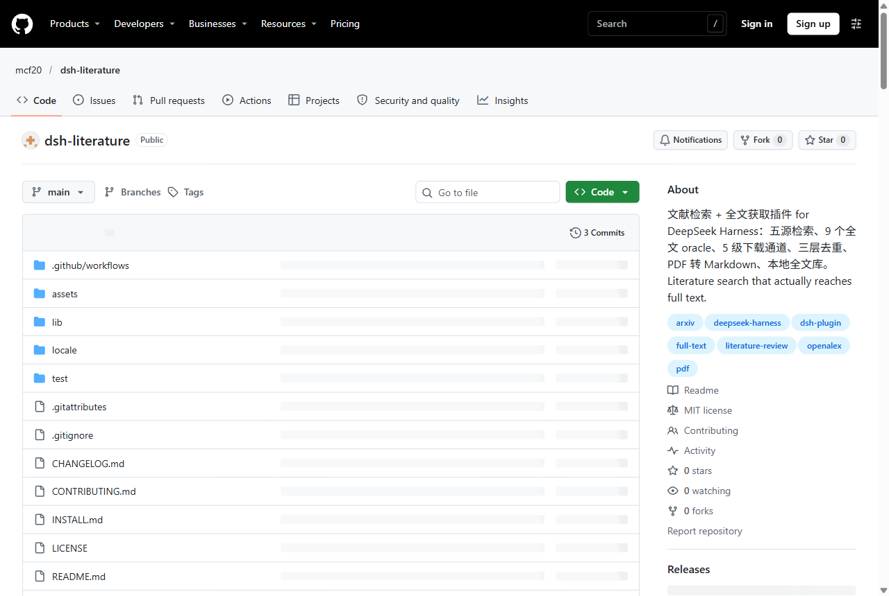
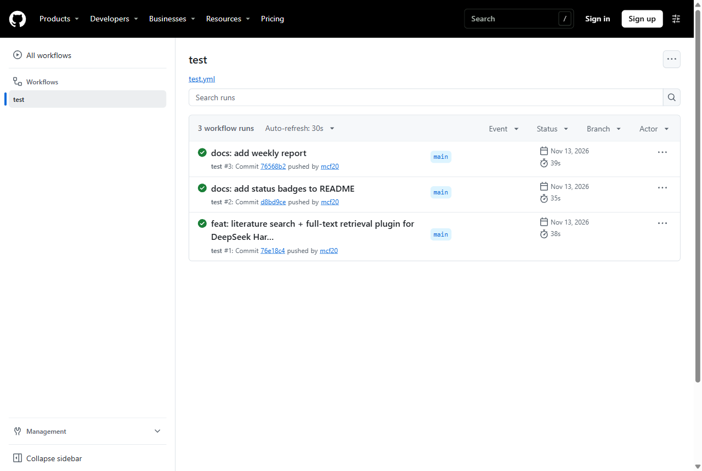

# 周报（成果版 · 突出交付）

**周期**：2026-11-10 ~ 2026-11-13
**项目**：dsh-literature —— 文献检索与全文获取插件
**状态**：v0.2.0 完成并开源

---

## 一句话总结

让"找论文"和"拿到全文"变成一件事：说一句话，论文的完整 PDF 就进了本地库。

---

## 交付物

| 交付 | 说明 |
|---|---|
| **可用插件** | 8 个工具，装进 DeepSeek Harness 即用 |
| **开源仓库** | https://github.com/mcf20/dsh-literature（MIT） |
| **一键安装** | `node install.mjs`，自动解包、装依赖、登记、自检 |
| **文档** | README（安装配置）、WORKFLOW（内部链路）、INSTALL（排错） |
| **测试** | 20 项纯逻辑测试，CI 三平台 × 两版本全绿 |
| **实证** | 18 篇真实论文全文入库，253 MB，全部可全文检索 |

---

## 能力清单

### 检索

5 个源并行：OpenAlex、Crossref、arXiv、PubMed、Semantic Scholar。
按 DOI 归一 + 标题 key 去重，**两个不同 DOI 永不合并**（预印本与正刊必须分开）。

### 取全文

9 个开放获取接口 + 5 级下载降级：

| 级别 | 机制 | 耗时 |
|---|---|---|
| ① | HTTP 直连 | 1–2 秒 |
| ② | 浏览器原生下载 | 5–20 秒 |
| ③ | 拦截响应字节 | 10–20 秒 |
| ④ | 文章页签名链 | 人工一次 |
| ⑤ | 手动下载自动导入 | 3 秒 |

### 质量控制

- **预览版拒绝**：1 页且不足 8000 字符不算成功
- **三层去重**：元数据 → 下载 URL → 内容哈希
- **三种失败分开报告**：要验证 / 要登录 / 机构没订阅

### 登录复用

自带持久化浏览器配置，登录一次永久复用，与日常浏览器完全隔离。

---

## 实证验证

**18 篇论文、7 条不同获取路径，全部实际跑通：**

| 路径 | 代表案例 |
|---|---|
| arXiv 直连 | BatteryAgent（6 页）、Battery-Sim-Agent（18 页） |
| Elsevier 官方 API | Acta Pharm Sin B（15 页 / 7.6 万字符）、Curr Opin（13 页） |
| Europe PMC | CRISPR 综述（49 页）、电池失效诊断（13 页） |
| ACS 订阅 | J. Med. Chem.（13 页） |
| Nature 订阅 | LeCun《Deep learning》（9 页） |
| 机构仓储作者稿 | Chem. Commun. 上转换发光（4 页） |
| 出版社 CDN | 两篇 EV 故障诊断（53 / 62 页） |

---

## 技术亮点

1. **分层降级而非单点突破**：某一级失败自动换下一级，并对失败原因分类
2. **绕开 PDF 阅读器**：让浏览器把 PDF 存成文件，这是 ACS / Nature 能全自动的关键
3. **内容级去重**：期刊版与预印本若同一份文件，只存一份并记别名
4. **不写反爬代码**：只用公开接口、授权通道和读者自己的浏览器会话

---

## 限制（如实）

1. 订阅刊的 PDF 导出不授权给科技接口，正文改走 XML（质量更高但无原版排版）
2. 中文文献（知网、万方）无公开 API，未接入
3. 图表不单独提取，表格公式会丢失
4. 部分出版社仍需人工点一次
5. 学校未订阅的刊物任何技术手段都拿不到

---

## 下一步

1. 找 2–3 位同学试用，收集真实失败案例
2. 中文文献通道可行性调研
3. 解析升级（MinerU / Docling）
4. 把试出来的超时值改成自适应

---

## 附图

**开源仓库**（Public，MIT，7 个话题标签）

**持续集成**（Windows / Ubuntu / macOS × Node 22 / 24，全部通过）

